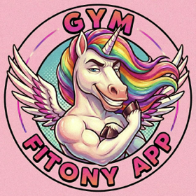

<p align="center">
  
</p>

<h1 align="center">FitOny</h1>

<p align="center">
  Offline-first strength training, periodization, and recovery companion built natively for <strong>iPhone + Apple Watch</strong>.<br/>
  <em>Source-Available Portfolio Repository — All Rights Reserved.</em>
</p>

---

## Overview
FitOny runs entirely on-device without cloud backends, accounts, or telemetry. It pairs periodization math with Apple Watch biometrics to manage hypertrophy blocks, set-by-set load adjustments, and recovery windows.

## Core Capabilities
- **Periodization & Hypertrophy Engine:** macrocycle phases (`Hypertrophy`, `Cut`, `Strength`, `Maintenance`), 4–6 week mesocycles with automatic deloads, 48-hour direct muscle recovery tracking, and plateau detection.
- **Workout Engine:** warm-up pyramids, double progression, intra-session autoregulation (`-5%` to `-10%` on premature failure or shortfall without overwriting baseline working weights), RIR-adjusted `e1RM`, and barbell plate breakdowns.
- **Apple Watch Companion:** live mirroring when iPhone is nearby plus local journal fallback, Digital Crown input, `HKWorkoutSession` heart-rate recovery (`HRR`) rest prompts, and wrist motion rep/slowdown hints.
- **Readiness & HealthKit:** 28-day personal baselines from sleep, nocturnal HRV, resting heart rate, and wrist temperature. Advisory-only by default — never cuts programmed weights automatically.
- **Bilingual Live Switch (`DA ⇄ RU`):** instant switching between Danish and Russian across iPhone, Watch, and Widgets with zero app restart.
- **On-Device Privacy:** isolated `Advanced Mode` encrypted with `CryptoKit` (`AES-GCM`) and locked by Face ID.

## Tech Stack
- **Language:** Swift 6 (Strict Concurrency)
- **UI & Charts:** SwiftUI, Observation (`@Observable`), Swift Charts
- **Persistence & Security:** SwiftData (`VersionedSchema`), CryptoKit, Keychain, LocalAuthentication
- **Apple Ecosystem:** HealthKit, CoreMotion, WatchConnectivity, WidgetKit, ActivityKit, AppIntents
- **Project Generation:** XcodeGen (`project.yml`) + local Swift Package (`FitOnyCore`)

## Repository Layout
- `Packages/FitOnyCore` — shared domain models and training math (tested independently via SwiftPM)
- `App-iOS` — iPhone app (`App/`, `Resources/`, `Storage/`, `Services/`, `Screens/`)
- `App-Watch` — Apple Watch app (`App/`, `Resources/`, `Sensors/`, `Screens/`)
- `Widgets` — `Live Activity` (iPhone) and `Complications` (Apple Watch)
- `project.yml` — XcodeGen manifest defining `FitOny-FreeSigning` and `FitOny-Full` schemes

## Running Core Verification (macOS CLI)
```bash
swift run --package-path Packages/FitOnyCore FitOnyCoreVerify
```

## Generating the Xcode Project
```bash
xcodegen generate
open FitOny.xcodeproj
```

## License & Intellectual Property
Copyright © 2026 **deusflow**. **All Rights Reserved.**

This repository is published as **source-available** for portfolio review and technical evaluation (e.g., via LinkedIn / GitHub profile). Copying, redistribution, modification, commercial use, or App Store submission of the code, training templates, or FitOny artwork/logo is strictly prohibited. See [LICENSE](LICENSE) for full terms.
